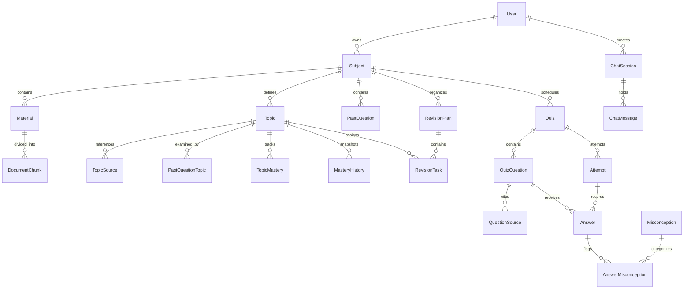

# GapFinder AI — Database Specification

## 1. Relational Entity-Relationship Design

The database schema models the complete academic diagnostic lifecycle across 21 entities:

---

## 2. Entity Definitions

### 1. `users`
- `id`: UUID (Primary Key, default gen_random_uuid)
- `email`: VARCHAR(255) (Unique, Indexed)
- `hashed_password`: VARCHAR(255)
- `full_name`: VARCHAR(255)
- `role`: VARCHAR(50) (default 'student')
- `created_at`: TIMESTAMPTZ (UTC)
- `updated_at`: TIMESTAMPTZ (UTC)

### 2. `subjects`
- `id`: UUID (Primary Key)
- `user_id`: UUID (FK -> users.id, ON DELETE CASCADE, Indexed)
- `name`: VARCHAR(255) (e.g., "AP Biology", "Data Structures & Algorithms")
- `code`: VARCHAR(50) (nullable)
- `description`: TEXT (nullable)
- `target_exam_date`: DATE (nullable)
- `daily_study_hours`: FLOAT (default 2.0)
- `created_at`: TIMESTAMPTZ
- `updated_at`: TIMESTAMPTZ

### 3. `materials`
- `id`: UUID (Primary Key)
- `subject_id`: UUID (FK -> subjects.id, ON DELETE CASCADE, Indexed)
- `title`: VARCHAR(255)
- `material_type`: VARCHAR(50) (SYLLABUS, TEXTBOOK, NOTES, PAST_PAPER)
- `file_path`: VARCHAR(512)
- `file_size`: INTEGER
- `mime_type`: VARCHAR(100)
- `content_hash`: VARCHAR(64) (SHA-256 for deduplication)
- `processing_status`: VARCHAR(50) (PENDING, PROCESSING, COMPLETED, FAILED, PARTIALLY_COMPLETED)
- `error_message`: TEXT (nullable)
- `total_pages`: INTEGER (default 0)
- `total_chunks`: INTEGER (default 0)
- `created_at`: TIMESTAMPTZ
- `updated_at`: TIMESTAMPTZ

### 4. `document_chunks`
- `id`: UUID (Primary Key)
- `material_id`: UUID (FK -> materials.id, ON DELETE CASCADE, Indexed)
- `subject_id`: UUID (FK -> subjects.id, ON DELETE CASCADE, Indexed)
- `chunk_index`: INTEGER
- `content`: TEXT
- `page_number`: INTEGER
- `chapter`: VARCHAR(255) (nullable)
- `section`: VARCHAR(255) (nullable)
- `token_count`: INTEGER
- `embedding`: JSON / VECTOR(1536) (pgvector or serialized vector)
- `content_hash`: VARCHAR(64)
- `created_at`: TIMESTAMPTZ

### 5. `topics`
- `id`: UUID (Primary Key)
- `subject_id`: UUID (FK -> subjects.id, ON DELETE CASCADE, Indexed)
- `parent_id`: UUID (FK -> topics.id, ON DELETE SET NULL, Indexed, nullable)
- `name`: VARCHAR(255)
- `code`: VARCHAR(50) (nullable)
- `description`: TEXT (nullable)
- `unit`: VARCHAR(255) (nullable)
- `chapter`: VARCHAR(255) (nullable)
- `learning_objectives`: JSON (List of strings)
- `exam_importance`: FLOAT (0.0 to 1.0, default 0.5)
- `exam_frequency`: INTEGER (default 0)
- `estimated_difficulty`: VARCHAR(20) (EASY, MEDIUM, HARD, default MEDIUM)
- `mapping_confidence`: FLOAT (0.0 to 1.0)
- `order_index`: INTEGER (default 0)
- `created_at`: TIMESTAMPTZ
- `updated_at`: TIMESTAMPTZ

### 6. `topic_sources`
- `id`: UUID (Primary Key)
- `topic_id`: UUID (FK -> topics.id, ON DELETE CASCADE, Indexed)
- `chunk_id`: UUID (FK -> document_chunks.id, ON DELETE CASCADE, Indexed)
- `relevance_score`: FLOAT
- `created_at`: TIMESTAMPTZ

### 7. `past_questions`
- `id`: UUID (Primary Key)
- `subject_id`: UUID (FK -> subjects.id, ON DELETE CASCADE, Indexed)
- `material_id`: UUID (FK -> materials.id, ON DELETE CASCADE, Indexed)
- `question_number`: VARCHAR(50)
- `question_text`: TEXT
- `subquestions`: JSON (nullable)
- `marks`: FLOAT (default 1.0)
- `year`: INTEGER (nullable)
- `exam_name`: VARCHAR(255) (nullable)
- `page_number`: INTEGER (nullable)
- `created_at`: TIMESTAMPTZ

### 8. `past_question_topics`
- `id`: UUID (Primary Key)
- `past_question_id`: UUID (FK -> past_questions.id, ON DELETE CASCADE, Indexed)
- `topic_id`: UUID (FK -> topics.id, ON DELETE CASCADE, Indexed)
- `mapping_confidence`: FLOAT (default 1.0)
- `created_at`: TIMESTAMPTZ

### 9. `quizzes`
- `id`: UUID (Primary Key)
- `subject_id`: UUID (FK -> subjects.id, ON DELETE CASCADE, Indexed)
- `title`: VARCHAR(255)
- `description`: TEXT (nullable)
- `quiz_type`: VARCHAR(50) (DIAGNOSTIC, TOPIC_TEST, COMPREHENSIVE, REASSESSMENT)
- `target_topic_ids`: JSON (List of UUIDs)
- `duration_minutes`: INTEGER (default 30)
- `total_marks`: FLOAT (default 0.0)
- `is_adaptive`: BOOLEAN (default false)
- `created_at`: TIMESTAMPTZ

### 10. `quiz_questions`
- `id`: UUID (Primary Key)
- `quiz_id`: UUID (FK -> quizzes.id, ON DELETE CASCADE, Indexed)
- `topic_id`: UUID (FK -> topics.id, ON DELETE CASCADE, Indexed)
- `question_text`: TEXT
- `question_type`: VARCHAR(50) (MCQ, MULTI_SELECT, TRUE_FALSE, SHORT_ANSWER)
- `difficulty`: VARCHAR(20) (EASY, MEDIUM, HARD)
- `marks`: FLOAT (default 1.0)
- `options`: JSON (nullable list of strings or dicts)
- `correct_answer`: TEXT
- `explanation`: TEXT
- `rubric`: JSON (nullable, grading criteria for short answers)
- `learning_objectives`: JSON (nullable)
- `order_index`: INTEGER (default 0)
- `created_at`: TIMESTAMPTZ

### 11. `question_sources`
- `id`: UUID (Primary Key)
- `quiz_question_id`: UUID (FK -> quiz_questions.id, ON DELETE CASCADE, Indexed)
- `chunk_id`: UUID (FK -> document_chunks.id, ON DELETE CASCADE, Indexed)
- `citation_snippet`: TEXT
- `page_number`: INTEGER (nullable)
- `created_at`: TIMESTAMPTZ

### 12. `attempts`
- `id`: UUID (Primary Key)
- `quiz_id`: UUID (FK -> quizzes.id, ON DELETE CASCADE, Indexed)
- `user_id`: UUID (FK -> users.id, ON DELETE CASCADE, Indexed)
- `status`: VARCHAR(50) (IN_PROGRESS, SUBMITTED, EVALUATED)
- `started_at`: TIMESTAMPTZ
- `submitted_at`: TIMESTAMPTZ (nullable)
- `score`: FLOAT (default 0.0)
- `max_score`: FLOAT (default 0.0)
- `percentage`: FLOAT (default 0.0)
- `time_spent_seconds`: INTEGER (default 0)
- `created_at`: TIMESTAMPTZ

### 13. `answers`
- `id`: UUID (Primary Key)
- `attempt_id`: UUID (FK -> attempts.id, ON DELETE CASCADE, Indexed)
- `quiz_question_id`: UUID (FK -> quiz_questions.id, ON DELETE CASCADE, Indexed)
- `student_response`: TEXT
- `is_evaluated`: BOOLEAN (default false)
- `score_awarded`: FLOAT (default 0.0)
- `max_score`: FLOAT (default 1.0)
- `is_correct`: BOOLEAN (default false)
- `evaluation_type`: VARCHAR(20) (OBJECTIVE, SEMANTIC)
- `feedback`: TEXT (nullable)
- `understood_concepts`: JSON (List of strings)
- `missing_concepts`: JSON (List of strings)
- `incorrect_concepts`: JSON (List of strings)
- `evaluation_confidence`: FLOAT (default 1.0)
- `created_at`: TIMESTAMPTZ

### 14. `misconceptions`
- `id`: UUID (Primary Key)
- `topic_id`: UUID (FK -> topics.id, ON DELETE CASCADE, Indexed)
- `category`: VARCHAR(50) (RECALL, CONCEPTUAL, APPLICATION, CALCULATION, TERMINOLOGY)
- `title`: VARCHAR(255)
- `description`: TEXT
- `corrective_strategy`: TEXT
- `created_at`: TIMESTAMPTZ

### 15. `answer_misconceptions`
- `id`: UUID (Primary Key)
- `answer_id`: UUID (FK -> answers.id, ON DELETE CASCADE, Indexed)
- `misconception_id`: UUID (FK -> misconceptions.id, ON DELETE CASCADE, Indexed)
- `evidence_excerpt`: TEXT (nullable)
- `created_at`: TIMESTAMPTZ

### 16. `topic_mastery`
- `id`: UUID (Primary Key)
- `user_id`: UUID (FK -> users.id, ON DELETE CASCADE, Indexed)
- `topic_id`: UUID (FK -> topics.id, ON DELETE CASCADE, Indexed)
- `subject_id`: UUID (FK -> subjects.id, ON DELETE CASCADE, Indexed)
- `mastery_score`: FLOAT (0.0 to 100.0)
- `status`: VARCHAR(20) (NOT_ASSESSED, WEAK, MEDIUM, STRONG)
- `confidence`: VARCHAR(20) (LOW, MEDIUM, HIGH)
- `evidence_count`: INTEGER (default 0)
- `correct_answers`: INTEGER (default 0)
- `incorrect_answers`: INTEGER (default 0)
- `conceptual_coverage`: FLOAT (0.0 to 1.0)
- `repeated_misconceptions`: JSON (List of misconception references)
- `diagnostic_explanation`: TEXT
- `last_assessed_at`: TIMESTAMPTZ (nullable)
- `previous_mastery_score`: FLOAT (nullable)
- `created_at`: TIMESTAMPTZ
- `updated_at`: TIMESTAMPTZ

### 17. `mastery_history`
- `id`: UUID (Primary Key)
- `user_id`: UUID (FK -> users.id, ON DELETE CASCADE, Indexed)
- `topic_id`: UUID (FK -> topics.id, ON DELETE CASCADE, Indexed)
- `attempt_id`: UUID (FK -> attempts.id, ON DELETE SET NULL, nullable)
- `mastery_score`: FLOAT
- `status`: VARCHAR(20)
- `confidence`: VARCHAR(20)
- `snapshot_timestamp`: TIMESTAMPTZ (UTC)

### 18. `revision_plans`
- `id`: UUID (Primary Key)
- `subject_id`: UUID (FK -> subjects.id, ON DELETE CASCADE, Indexed)
- `user_id`: UUID (FK -> users.id, ON DELETE CASCADE, Indexed)
- `version`: INTEGER (default 1)
- `start_date`: DATE
- `end_date`: DATE
- `daily_allocated_hours`: FLOAT
- `status`: VARCHAR(50) (ACTIVE, SUPERSEDED, COMPLETED)
- `summary`: TEXT
- `adaptation_reason`: TEXT (nullable, explaining what changed between versions)
- `created_at`: TIMESTAMPTZ

### 19. `revision_tasks`
- `id`: UUID (Primary Key)
- `revision_plan_id`: UUID (FK -> revision_plans.id, ON DELETE CASCADE, Indexed)
- `topic_id`: UUID (FK -> topics.id, ON DELETE CASCADE, Indexed)
- `scheduled_date`: DATE
- `allocated_minutes`: INTEGER
- `priority_score`: FLOAT
- `recommended_activity`: VARCHAR(100) (CONCEPT_REVIEW, PRACTICE_QUESTIONS, MISCONCEPTION_DRILL, RETENTION_CHECK)
- `learning_objective`: TEXT (nullable)
- `supporting_material`: TEXT (nullable)
- `expected_outcome`: TEXT (nullable)
- `is_completed`: BOOLEAN (default false)
- `completed_at`: TIMESTAMPTZ (nullable)
- `order_index`: INTEGER (default 0)
- `created_at`: TIMESTAMPTZ

### 20. `chat_sessions`
- `id`: UUID (Primary Key)
- `user_id`: UUID (FK -> users.id, ON DELETE CASCADE, Indexed)
- `subject_id`: UUID (FK -> subjects.id, ON DELETE CASCADE, Indexed)
- `topic_id`: UUID (FK -> topics.id, ON DELETE SET NULL, nullable)
- `title`: VARCHAR(255)
- `created_at`: TIMESTAMPTZ
- `updated_at`: TIMESTAMPTZ

### 21. `chat_messages`
- `id`: UUID (Primary Key)
- `chat_session_id`: UUID (FK -> chat_sessions.id, ON DELETE CASCADE, Indexed)
- `role`: VARCHAR(20) (USER, ASSISTANT, SYSTEM)
- `content`: TEXT
- `citations`: JSON (List of chunk citations with document name, page, excerpt)
- `created_at`: TIMESTAMPTZ
